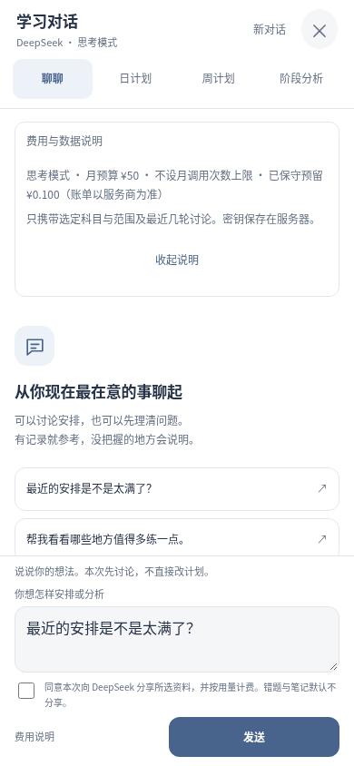
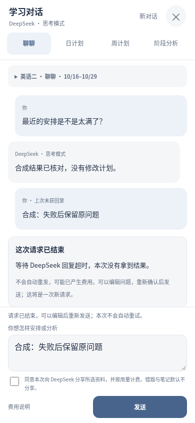

# AI 请求失败与恢复

旧版把上游 HTTP 错误、超时、输出长度和 JSON 校验失败统一写为 `unknown`，手机又把所有 `unknown` 当成等待中的请求，反复查询同一条已经结束的失败。费用浮层在输入被锁定时也无法通过聚焦输入框收起。

## 现在怎样区分

- `pending` 或派生的超时未确认仍然可以查询，查询不调用模型。
- 已写入失败收据的 `unknown` 返回 `terminal: true`。手机显示系统失败卡，不冒充模型回复；解除等待锁定，保留同页可恢复的问题，重新发送前清除旧计费与复盘分享确认。
- 旧失败收据不改写，读取时标记结束。旧版没有记录具体原因时明确说明，不能事后猜成密码、网络或余额问题。
- 新失败只保留受控错误枚举：认证、账户余额、限流、请求兼容性、超时、服务不可用、格式或输出长度。绝不保存或打印原始供应商错误正文、内部思考或密钥。
- 失败和查询不自动重复调用、不清空预算预留、不修改计划。用户主动编辑后重新发送才创建新的请求 ID；失败问题不会作为重复的历史消息再次传给模型。
- 费用说明进入对话的滚动区，有明确收起入口，输入框和查询按钮不再被浮层遮挡。

## 只读生产诊断

复用受保护的 `deepseek-configure.yml`，增加 `diagnose-readonly`。只读已安装的服务器配置，向官方 `/user/balance` 和 `/models` 发 GET；输出认证 HTTP 状态、账户可用／正余额布尔值、配置模型是否列出及安全失败枚举。既不打印余额金额，也不读取学习快照、问题正文或成功的私人回复。不会安装配置或调用付费模型。

本人已明确允许收费时，可单独勾选 `verify_chat`：先确认官方账户有余额，再通过现有 App 的所有者认证、预算和版本机制发送一次最小只读对话。没有激活、科目授权或计划提交路由；不自动重试，不暂停或重置现有设置。只输出结果分类和 token 用量，双科快照及授权前后比较若遇到并行更新则停止，绝不回写旧数据。应用月预算并不是 DeepSeek 账户充值。

## 安全维护升级

`private-plan-release.yml` 的 `preserve_ai_config` 默认关闭，首次升级仍采用原来的 AI 关闭策略。已获得上线和费用授权的维护修复可以显式选择保留现有配置：

1. 在停止服务前后拒绝进行中的对话或自动执行。
2. 私有一致性备份并校验；只初始化兼容的附加表。
3. 保留密钥、费用、次数、批准版本和服务器开关，升级前后逐字节比较环境配置。
4. 核对全部旧学习数据、授权、AI 收据和币种账本未改变，健康失败恢复代码和配置。

原生产数据库不被替换。本次没有新增学习数据迁移、自动授权或重新导入档案。真实生产结果见对应 PR／Actions；合成测试和截图不代表真机或真实付费验收。

## 合成浏览器预览

390×844 Chromium 实际渲染，预算、问题和失败均为合成数据，不代表生产账户状态。

| 费用说明不遮挡输入 | 已结束失败可以重新编辑 |
| --- | --- |
|  |  |
