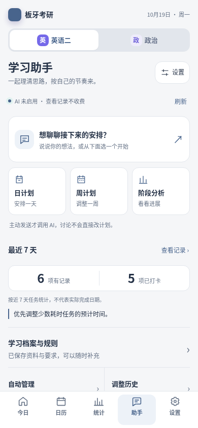
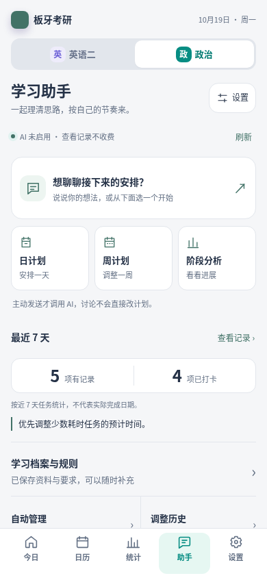
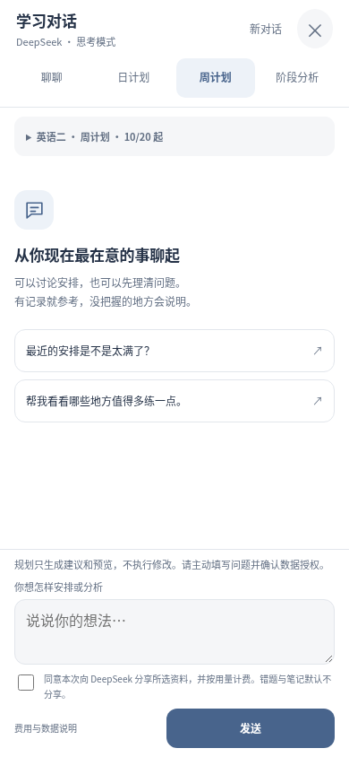
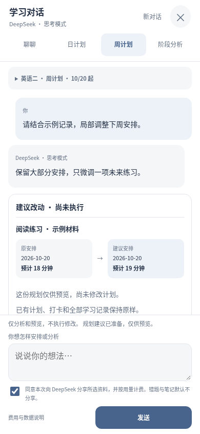
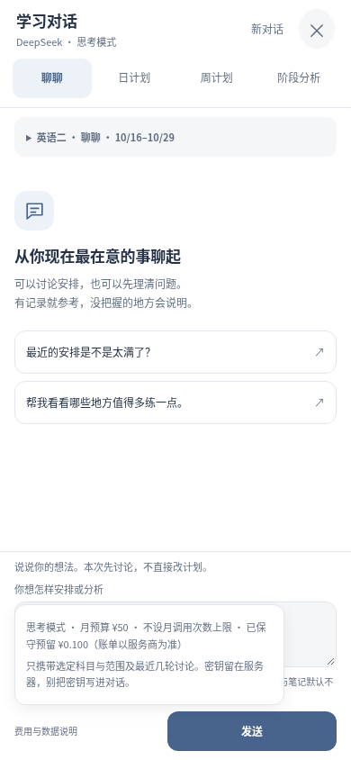

# 学习助手体验优化

把聊天与日／周／阶段规划放到助手首屏，近期记录收敛成一组数据和一条有依据的提示。没记录、没联网和读取失败分别说明；查看近况和刷新状态不调用模型。

聊天改为全屏移动布局：上方阅读，中间显示科目／模式／日期，底部固定输入与发送；费用详情按需展开。未核实结果才出现“查询结果”，避免反复付费；有内容时开始新对话或切换方式会提示。计划建议分列显示原安排与建议安排，计划时间和实际用时不混用。

未发送文字在同一页面会话内按科目保留，关闭重开或切科不会互相覆盖。分享和计费同意不随草稿恢复；切科清除临时可用分钟。草稿仅在内存，刷新或关闭浏览器后不保证保留，没有新增学习存储键或修改同步协议。

## 真实渲染预览

全部使用合成记录和模拟模型。首页“未启用”是测试夹具状态，不代表生产 AI 状态。以下为390×844浏览器视口；不是Android真机截图。

| 英语二首页 | 政治首页 |
| --- | --- |
|  |  |

| 学习对话 | 建议前后对照 |
| --- | --- |
|  |  |

| 人民币费用说明 | 结果待核实 |
| --- | --- |
|  |  |

## 验证与发布边界

本地158项Node、160项Python通过；双科真实同步模块在隔离后端的上传、模拟调整、接收、撤销和离线冲突回归通过。

360×800、390×844、412×915双科84张合成截图通过；另检查480像素可见高度的输入操作、草稿隔离、模式／示例不自动发送、人民币显示、未确认结果查询恢复、减少动态效果和离线重开。完整PNG和HTML索引随Validate planner的mobile-acceptance artifact提供，代表截图随仓库保留。

本轮不更改后端、密钥、收费预算、自动管理授权或真实学习记录，不运行真实付费调用。CI、ECS发布及线上验证结果记录在对应PR；浏览器模拟不代替真实手机键盘与返回手势验收。
