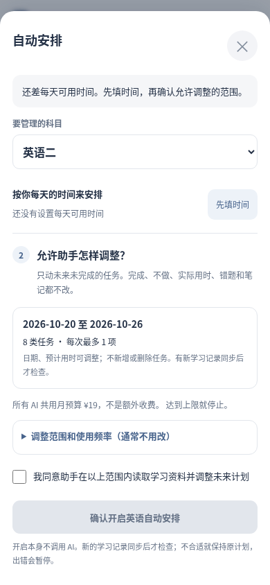

# 学习助手：先分清用途，再做设置

## 日常只需要走自己的那条路

| 我想做什么 | 在哪里操作 | 需要填写什么 | 会不会改计划 |
| --- | --- | --- | --- |
| 讨论安排、看看建议 | 学习助手 → 聊天／日计划／周计划 | 直接说需求；日计划可补当天可用时间 | 讨论不写入，规划先预览；普通建议只有明确确认才提交 |
| 让助手在范围内自动安排 | 学习时间与偏好 → 下一步：设置自动安排 | 每天可用时间，再确认未来日期及调整范围 | 只有本人开启后，服务器校验通过才改未来任务 |
| 告诉助手目标、习惯、学习基础 | 学习时间与偏好 → 目标、偏好和历史基础（选填） | 一条清楚的说明即可；历史／当前进度需要相应日期 | 不改打卡，也不产生模型费用 |
| 看调整原因或撤销 | 调整历史 | 不必填写档案 | 撤销仍需核对版本，有新记录就停止 |

每天可用时间是规划参考，与任务打卡中的实际用时完全不同。英语默认不包含背单词；政治可以补充其中实际看课最多多久。没有可靠资料的部分保持未知，不能为了启用而推测预算或导入历史打卡。

## 这次修复的交互

- 聊天固定输入栏只作用于 `.ai-chat-sheet`。档案、免费诊断和自动安排继续独立滚动，避免复用 `.ai-sheet` 后表单被裁掉。
- 时间设置是首屏独立表单，保存后显示下一步；未保存的时间修改不能进入下一步。目标、历史、规则及来源放入选填区域，不再要求先理解通用档案字段。
- 自动安排按“已有时间 → 允许范围 → 一次确认”呈现。本人确认保存科目授权后，必要时启用总开关；不再要求来回切换两道开关。读取页面不会创建授权。日期、任务类型或限额变动时实时更新摘要，并清除上一次范围确认。
- 总费用从现有 AI 状态读取，说明自动安排与聊天共用总预算；后台频率和科目费用限制放入可展开选项，不假装取消服务器保护。
- 开启后提供本学科暂停、现在检查一次和免费刷新。检查按钮只提交现有去重队列，有调整必要且预算允许时才进入模型。不会因打开页面或保存时间调用模型。
- 授权到期明确说明需要重新确认；重新保存的起始日只能是未来，不把旧授权悄悄续期。
- 时间档案读取失败会阻止开启，但仍允许暂停已有授权。保存或开启结果不确定时先读取实际状态，提示免费核对，不自动重试写入或收费请求。

## 数据与接口

复用现有私人档案接口、学习政策和自动管理接口。时间表单生成结构化 `budget` 和政治可选 `course_limit`，沿用 owner 认证、请求幂等、版本比较和事务历史备份。只更新本人确认的条目，不重置档案，不动学习快照。旧硬性规则仍由服务器校验。

浏览器 `BanyaStudySetup.policy` 只帮助显示最新有效的本学科设置；后端 `learning_policy.py` 和自动执行器仍是权限与写入裁决者。缺时间、历史估计、过期信息或跨科目数据不能用作可靠预算。

开启时先用现有手机同步预检，然后保存科目范围，必要时开启总开关。发生并发冲突停止，重新读取状态；不会覆盖授权版本。关闭页面可取消尚在预检、尚未提交的开启操作。已经提交的请求仍需读取状态确认。

没有更换 PWA 身份、存储键、云同步协议、Worker、ECS 地址、API 配置或真实授权。本轮开发和截图使用合成学习资料、模拟模型，真实付费请求为零。正式发布状态以 PR 与 Actions 为准。

## 合成手机尺寸预览

下图为 390×844 Chromium 实际渲染，数据和预算均为测试夹具，不能当作生产设置或 Android 真机验收。

| 英语每天可用时间 | 政治总时间与看课时间 |
| --- | --- |
|  |  |

| 缺少时间时的明确入口 | 一次确认调整范围 |
| --- | --- |
|  |  |

完整 360×800、390×844、412×915 双科 PNG 与 HTML 索引随 Validate planner 的 mobile-acceptance artifact 下载。测试包含未知时间 → 私人档案保存 → 一次开启 → 检查 → 模拟调整 → 撤销，另覆盖选填表单与免费诊断滚动、返回、草稿、离线缓存及同步隔离。

本轮本地验证：169 项 Node、165 项 Python、隐私／语法／ECS 静态包检查通过；108 张手机尺寸截图、6 组双科浏览器流程通过。真实 DeepSeek 请求为零，未执行 Android 真机或生产自动调整验收。
