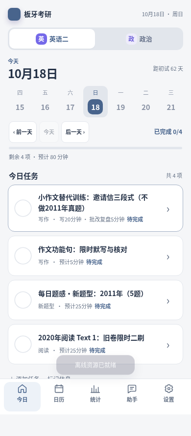

# M7.3 移动界面

五个固定页签：今日、日历、统计、助手、设置。助手与设置分开，首页优先任务。共享组件和 CSS 变量控制两科相同的层级、触控尺寸与状态，只改变低饱和强调色。动效短于 200ms，并尊重减少动态效果。

路由元数据仅保存在当前标签页的 sessionStorage（banya_ui_route_v1），不包含学习记录，不上传服务器。系统返回关闭详情或弹层；刷新恢复当前页、科目及所选日期。原 manifest、localStorage 学习键和云同步格式不变。

政治统计与英语统一读取真实保存的记录，不把计划日期认作实际学习日期。总用时缺失显示未知；历史题库手动登记保留在折叠区。政治时间拆分复用 PlannerCore.actualTimes，错误输入不会保存。

验证：运行 scripts/validate.sh。浏览器验证见 scripts/mobile_smoke.py，需本地静态服务器及 Playwright/Chromium；截图只使用空设备和公开模板，无私人记录。验证包括三种宽度、两科五页、刷新恢复与日历返回。真机键盘、手势和长期离线仍需未来上线后的手机验收。

## 自动管理集成

助手页的“AI 自动管理与修改历史”使用现有所有者认证和固定接口允许列表。仅查询状态不会调用模型。开启需要服务器就绪、科目授权、明确同意与费用上限；权限和总开关均有版本校验。撤销先核对手机同步，再向专用后端提交当前版本，最后同步手机；服务器若发现新学习记录会拒绝撤销。

`scripts/autonomy_browser_smoke.py` 使用真实本地 FastAPI 路由、临时合成 SQLite 和注入模型运行双科授权→模拟提交→收据→撤销，不访问任何生产数据。两次注入模型调用，真实付费次数为零。

## 浏览器截图

以下为 390 CSS px 空设备与公开模板的浏览器截图，不包含私人打卡，也不是生产或 Android 真机截图。

| 英语二 | 政治 |
| --- | --- |
|  |  |
