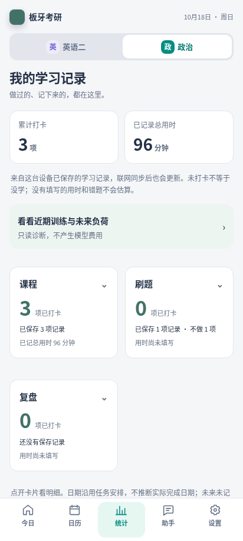

# M7.4 移动端视觉与交互验收

基于开放 #60（18fc637），不合并、不部署、不读取真实私人数据、不配置密钥、不调用真实模型。

## 截图交付

CI 的 Validate planner → mobile-acceptance 会运行 `scripts/visual_acceptance.py`，上传 `m74-mobile-synthetic-<SHA>` artifact。下载 ZIP 后打开 `index.html` 可查看全部图片，`report.txt` 对应实际通过的场景。保留14天，过期可重新运行安全验收工作流；不触发生产发布。

完整矩阵：360×800、390×844、412×915；每种尺寸分别检查英语二与政治的今日、日历、日期详情、任务详情、统计、助手首页、对话、规划预览、自动授权、修改历史、学习档案、设置，共72张严格视口截图。

所有任务、档案、记录、模型响应都由临时合成夹具生成，没有引用用户私人档案。浏览器通过暴露的测试绑定连接本地真实 FastAPI 和 SQLite，注入模拟模型；视觉套件不代替真实云传输或 Android 真机测试。Service Worker 离线重开使用真实浏览器缓存。

PR 内可直接审查的代表截图：

| 今日（360） | 助手（390） |
| --- | --- |
|  |  |

| 调整历史（390） | 政治统计（412） |
| --- | --- |
|  |  |

## 视觉审查与修改

- 今日继续以日期和任务为主，不加入品牌 Banner 或长篇 AI 回复。
- 助手从并列按钮堆叠改为近况、规划、工具列表；确定性近况只读，不调用模型。缺失或断网显示未知，不编造分析。
- 统一标题、按钮、输入、提示与来源折叠区。任务说明、错题、笔记按需展开，实际用时与计划编辑分开；窄屏时间字段使用单列。
- 修改历史有独立阅读视图，展示日期/预计用时前后对照、解释及撤销；不展示任务内部 ID。
- 统计保留真实记录口径，提供不收费的诊断和未来负荷入口。

## 已复现并修复

重复点击当前标签堆积 history；政治日历返回/刷新丢失独立月份；关闭遮罩或加载其他窗口记录后弹层内部状态未清理、无法重开；助手启用/授权修改后首页缓存短暂陈旧；日期详情 history 未保存当前日期及详情标记。

Node 回归与浏览器测试覆盖这些行为，并检查三种宽度无横向溢出、任务原实际时间可读、规划无确认执行入口、默认关闭、双科授权/模拟调整/撤销与暂停、离线缓存重开。数据结构、manifest 身份、学习存储键、公开计划文件和同步协议不变。

真实 HONOR/Android 键盘、手势及长期使用，生产 HTTPS/升级和真实 DeepSeek 账号响应，仍需未来另行授权验收。
